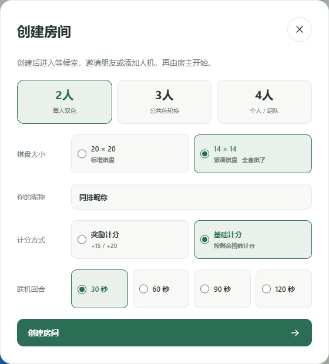
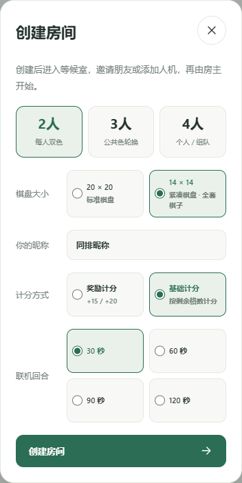
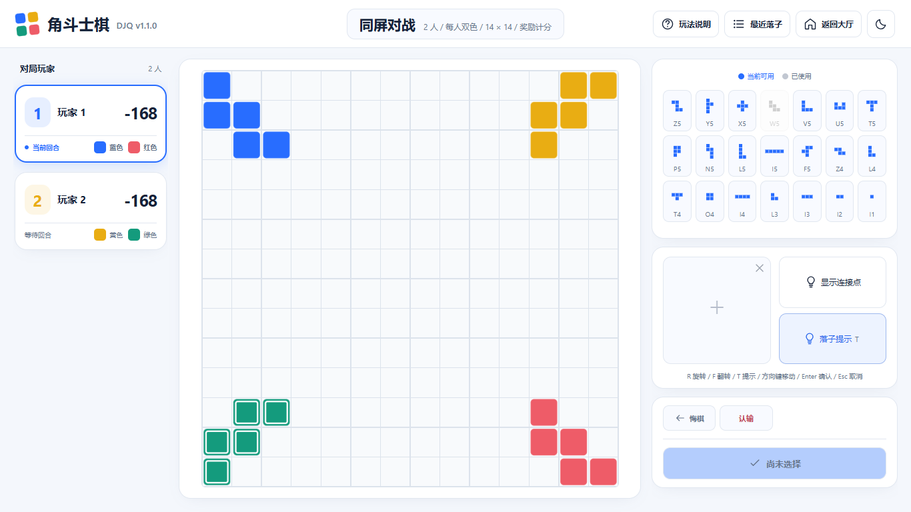

# 14×14 双人双色与设置对齐 · 2026-10-25

同屏和创建房间均可在选择两人后，切换20×20标准棋盘或14×14紧凑棋盘。两位玩家分别控制蓝红、黄绿，仍按蓝、黄、红、绿轮流落子，四色库存各21块，总共84块不变。14×14从实际四角开始，保持原有连接、阻挡、跳过和计分规则。

棋盘尺寸贯穿规则、穷尽搜索、提示与机器人、拖动/旋转/翻转边界、浮动操作、房间快照、恢复、悔棋、再开和棋谱。API使用`boardSize: 14 | 20`，14仅允许两人；省略时默认20。新V2棋谱带尺寸，旧V1/V2记录继续按20×20读取。

设置面板统一标签列与控件列，昵称及房间号与输入框同排；人数、棋盘、四人玩法、计分、回合时限和人机席位均直接显示可见选项。单选框支持键盘操作，改变棋盘或玩法后保留焦点。昵称在新打开页面时随机生成，手工修改在本次设置过程中保留，不再从旧的昵称存储项覆盖默认昵称。

验证记录：

- `npm run verify`：78项原生测试、语法/导入检查和构建通过。
- `npm run test:browser`：45项测试通过，包含原有模式/布局/触摸/恢复及4项14×14专项测试。最后的标签字重和选项焦点微调后，4项专项再次通过。
- 独立穷尽枚举对照覆盖14×14的所有位置和8种变换；完整机器人对局校验面积守恒、终局和棋谱恢复。
- 实际本地HTTP/SSE、浏览器Worker、服务端机器人、四角落子、手机拖动、竖横屏、悔棋、导出/导入与再开均已验证。
- 人工检查桌面设置、手机浅/深色设置和14×14对局截图。浏览器触屏模拟不代替实体Android/iOS验收。

预览：

