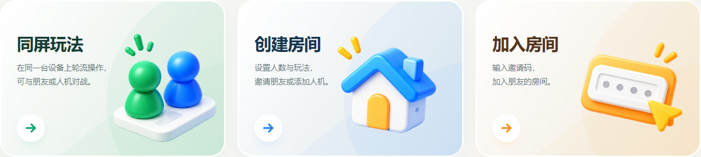
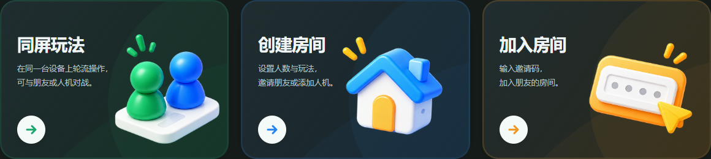
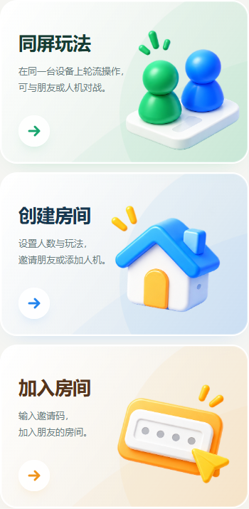

# 首页入口卡片

按用户提供的两张参考图实现绿色同屏、蓝色创建、橙色加入三个入口。复用用户的透明PNG图集，卡片采用柔和渐变、弧形色层、圆形箭头与轻微悬停反馈。深色主题提供对应配色；减少动态效果偏好下停用位移。整张卡片是原生按钮，保留键盘焦点、房间占用时的禁用状态及原有三种弹窗流程。

桌面三列；平板调整图标大小与文案布局；手机单列。图标为装饰图，不进入无障碍名称，也不拦截点击。文案使用真实HTML，不嵌在图片中。

验证：`npm run verify`通过（70项原生测试、构建）；大厅浏览器套件3项通过。另检查1440、1024、768、390和360px宽度，均无横向溢出，图集正常加载；浅深色截图均已检查。

