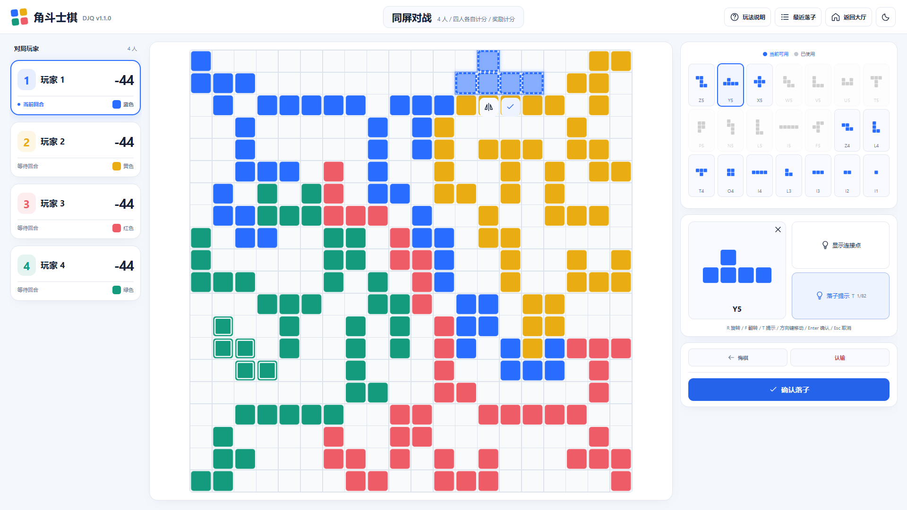
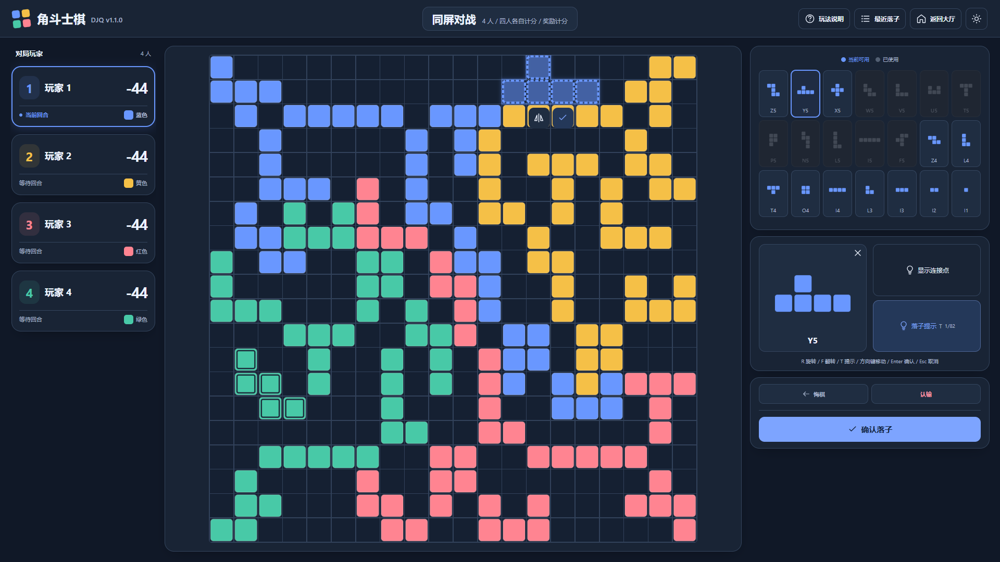
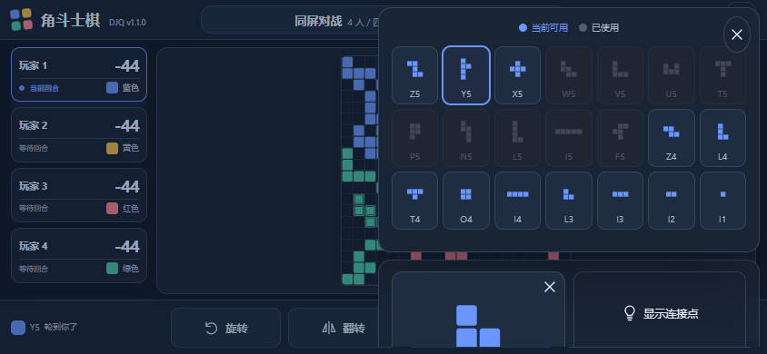
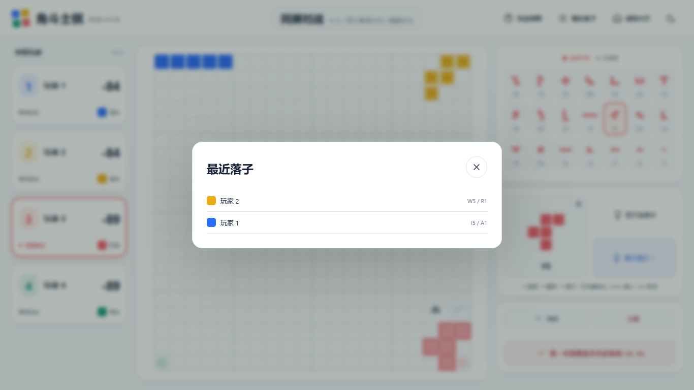
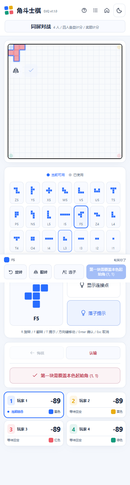
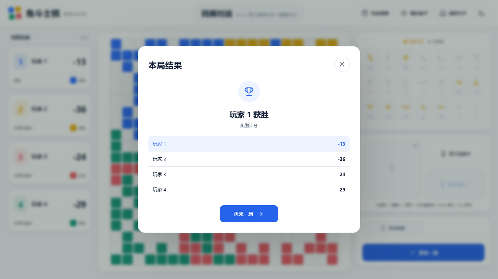

# 对局 UI 2.0 交付说明

## 提示词评估与范围

本次按用户提供的任务文本和参考图实现，功能要求彼此兼容。落地时明确了三点：参考图中的棋盘、分数仅作为视觉示意；额外保留醒目的确认落子按钮；顶部不添加空壳设置入口，提供真实可用的玩法、主题和返回大厅操作。

从已核对的主分支 `fb73d1b8275fdd563010fce3ed4a3fd613ed2855` 建立 `feat/game-ui-v2-landscape`，初期交付供审核；本轮用户已授权推送仓库并部署到正式站点。UI 2.0 是界面版本，未改变现有 v1.1 游戏规则、棋谱或 API 版本。

## 实施与结果

1. 将原来的顶部玩家卡片与两栏布局改成左侧玩家、中间棋盘、右侧选子/操作三栏；顶部集中显示真实玩法、人数、计分方式和联机房间信息。
2. 左侧卡片从规则引擎计算并显示真实得分，保留颜色、当前回合、思考、离线、认输、结束、双色合计、公共绿和组队信息；按后续反馈移除身份副标识与剩余格数文案。
3. 右侧保留21种真实 SVG 棋形。放大预览与落子姿态使用同一状态，型号居中显示在棋形下方，省去数量、颜色和角度等副文案。
4. 预览旁仅保留连接点与落子提示，提示支持T键；旋转、翻转通过棋盘与快捷键操作。确认按钮合并合法性反馈，合法时显示确认、非法时显示原因，网络等待时禁用。棋形列表、选择预览、辅助操作分别成卡片，卡片高度随内容，日志由顶部按钮打开弹窗；棋谱导出仅在结束后显示。
5. 棋盘容器由 CSS 分配可用空间，再由 ResizeObserver 取实际宽高的较小值设置正方形 SVG；600×600 viewBox 和逻辑坐标不变。
6. 短横屏（宽≥600、视口高≤560且横向）使用两栏状态/棋盘与操作抽屉，底部固定关键操作。抽屉开启时背景 inert、焦点限制在抽屉内，Esc 返回选子按钮；选择或取得建议后可直接回棋盘。手机竖屏保留自然滚动与固定操作栏。
7. 页面重绘恢复已有控制焦点；同局面SSE更新继续等到拖动结束再重绘。窗口旋转关闭旧抽屉，重新适配棋盘。

2026-10-17 界面精简：移除棋盘四角的标题、行动玩家、落子数和操作提示，以及颜色块字母、身份副标识、剩余格数和棋形说明副标题。联机计时移至顶部；待确认棋子增加同色外轮廓呼吸光效（不照亮内部接缝），确认后消失，减少动态效果偏好下使用静态光效。右侧旋转/翻转改为上下排列。

后续操作区精简：移除选子标题和库存比例；可用/已使用图例居中，放大棋子仅保留正下方居中的型号。快捷键说明置于独立预览卡片底部中央；日志按钮位于玩法说明右侧，弹窗展示完整行动历史并接收联机更新。选择、变换、取得建议后恢复棋盘焦点，修复鼠标选子后Enter只会再次激活棋子按钮的问题；输入框和弹窗保留正常键盘行为，重复Enter不重复提交。品牌和网页标题统一使用项目实际版本v1.1.0，版本元数据由检查脚本与package.json核对，删除保存文案与页脚版本。

本轮布局与落子交互：玩家颜色移到回合状态后面；竖屏按棋盘、拼图与操作、玩家席位的顺序排列，选子保持页面滚动位置，预览卡片和变换按钮平分行宽，预览保持正方形。连接点、导出、悔棋、认输和确认独立成另一张卡片。待落拼图旁新增跟随移动的镜像、打勾按钮，靠近棋盘边缘时自动换侧并限制在盘内，非法落点的打勾禁用。结果改为每局自动打开一次的弹窗，可关闭查看棋盘；关闭后主题或联机状态刷新不会反复弹出。“再来一局”在弹窗与主确认位置可用，联机仍由房主发起。

本轮进一步精简：顶部对局信息始终在视口水平中央；所有尺寸的预览框都保持正方形，与右侧按钮等宽。删除预览旁的旋转、翻转按钮，保留棋盘上的点击旋转、浮动镜像按钮与R/F快捷键，连接点置于提示上方。结束后不再显示悔棋、查看结果和手机底部操作栏；短横屏结束后直接显示侧边操作区，保留导出和主确认位置的“再来一局”。大厅删除英文标语、卡片英文副标题和LET’S PLAY装饰标题。

大厅入口重构：同屏玩法、创建房间、加入房间三种入口分别打开原生弹窗；创建/加入后在大厅显示等候室弹窗，开始后才进入棋盘。等候室可添加/移除人机、复制邀请链接和退出；关闭弹窗保留席位，通过“返回房间”重新打开。邀请链接预填加入菜单。重复提交和提交中关闭受到限制，错误保留在菜单内；房间中禁用新建、加入、切换存档等入口，避免遗留在线席位。返回大厅使用home图标。

房间生命周期继续由现有服务端统一管理：等候室离线真人席位保留2分钟，房主离开转移给其他真人；最后一位真人退出立即清理房间；无连接15分钟、等候室无操作30分钟、结束30分钟或创建超过8小时会清理。开始后断线缩短当前真人期限至最多45秒，并保留恢复凭证；再开回到等候室。房间不跨服务重启持久化，生产发布前检查活动连接，保留旧发行版与服务配置以便回滚。

本轮卡片调整：棋形库存与选择预览为独立自动高度卡片，快捷键放入预览卡片底部居中；辅助操作仍独立成卡片，空间不足时右栏局部滚动。待落棋子的浮动镜像/打勾按钮去掉外围容器边框和按钮描边。导出仅在结束后出现。

## 文件清单

| 文件 | 用途 |
| --- | --- |
| `public/app.mjs` | 顶部、玩家卡片、三栏、操作区、抽屉、焦点和选中预览接线；复用既有游戏动作 |
| `public/game-ui.mjs`（新增） | 共享棋形SVG展示、放大选择预览、外轮廓、跟随按钮位置与棋盘宽高观察 |
| `public/game.css`（新增） | 仅作用于对局/复盘的布局、浅深色变量和响应式规则 |
| `public/index.html` | 加载独立对局样式 |
| `public/i18n.mjs` | 玩家状态、选择预览和抽屉中文文案 |
| `server/index.mjs` | 仅注册两个新增公开资源；未改HTTP/SSE、鉴权和房间逻辑 |
| `package.json` | 将新增布局套件纳入 `test:browser` |
| `tests/browser_layout.mjs`（新增） | 尺寸/模式/预览/键盘/导出/抽屉/旋转/SSE拖动回归与截图 |
| `tests/game-ui.test.mjs`（新增） | 外轮廓无内部接缝、跟随按钮四角边界和移动回归 |
| `tests/browser_lobby.mjs`（新增） | 大厅菜单、校验/取消、单次提交、等候室恢复、房主转移与最后真人退出 |
| `tests/browser_helpers.mjs`（新增） | 各浏览器套件共用真实弹窗入口 |
| `tests/browser_controls.mjs`（新增） | Enter/T、跟随按钮、竖屏滚动/比例/顺序、结果与日志弹窗、重复提交保护 |
| `scripts/check.mjs` | 核对网页版本元数据、标题与package.json一致 |
| `docs/UI_V2_VERIFICATION.json`（新增） | 本轮实际验证记录 |
| `docs/screenshots/ui-v2/`（新增） | 浅色、深色、手机横屏的真实浏览器截图 |
| `README.md`、`docs/TESTING.md`、本文 | 功能入口、验证方法与交付说明 |

`shared/`、机器人策略/线程池、房间模块、网络客户端和精确拖动几何模块均未修改。没有新增框架或运行依赖。

## 实际测试

- `npm run verify`：语法/导入检查、原生测试、构建。
- `npm run test:browser`：原有玩法和席位恢复，加新增布局套件；实际HTTP来源、原生存储、CSP、SVG、Web Worker和CDP触屏事件。
- 浏览器覆盖尺寸：1920×1080、1600×900、1366×768、1280×800、1024×768、844×390、932×430、390×844、360×800。
- 额外检查双色总剩余178、普通单色89、三人公共绿、队伍总分、非法F5首手禁用、旋转/翻转/Esc、焦点恢复、记录展开、悔棋、导出下载、只读复盘、回放滑块、横竖屏切换、抽屉焦点与SSE拖动中断线。
- 原有真人/机器人完整对局、联机组队/再开、本地恢复与跨标签页恢复测试继续执行。

具体计数、棋盘测量和验证边界见 [验证记录](UI_V2_VERIFICATION.json)。截图由合法行动历史重放生成，截图中的得分/库存/落点均来自真实状态；没有为效果图伪造棋盘。

## 界面截图

桌面浅色：

桌面深色：

手机横屏操作抽屉：

顶部日志按钮打开的弹窗：

竖屏拼图、独立操作卡片和席位顺序：

可关闭的结果弹窗：

## 验证边界

已在当前主机的 Edge/Chromium 中验证；实体安卓/iOS Safari、其他浏览器实机触感与生产域名部署验收尚未执行。手机横屏进行中时棋子在抽屉内局部滚动，结束后侧边操作区直接显示，操作可在右栏滚动访问。未发现阻塞自动化验收的功能问题。
